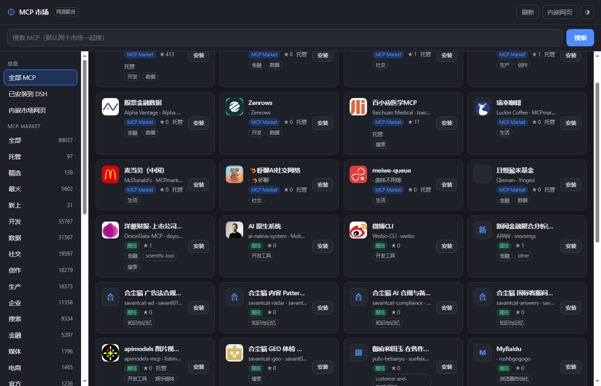
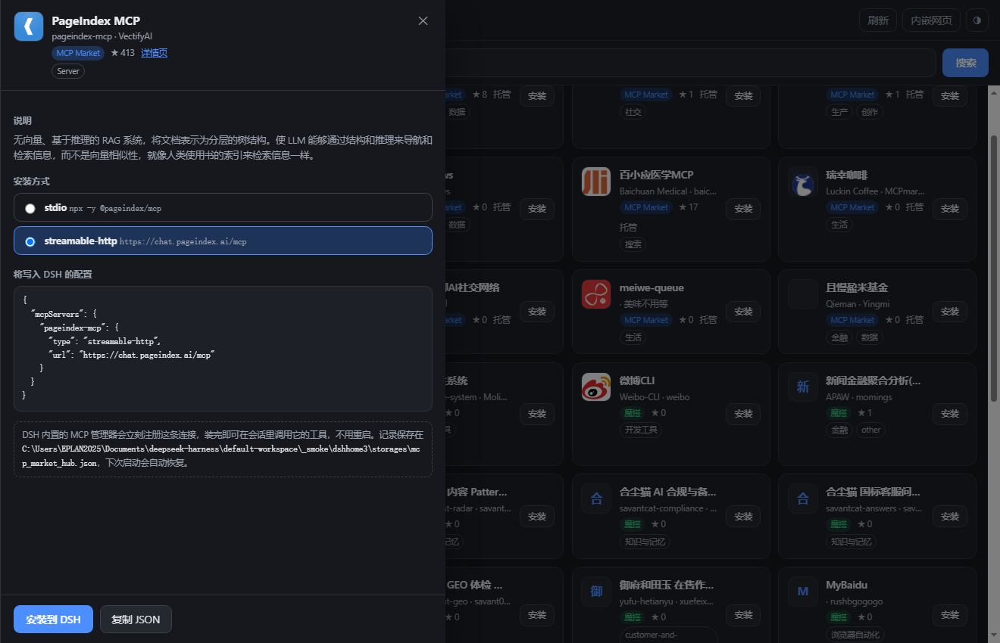
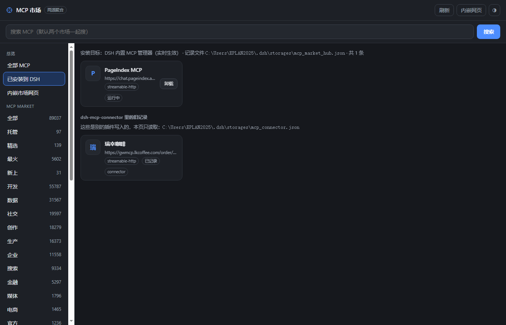
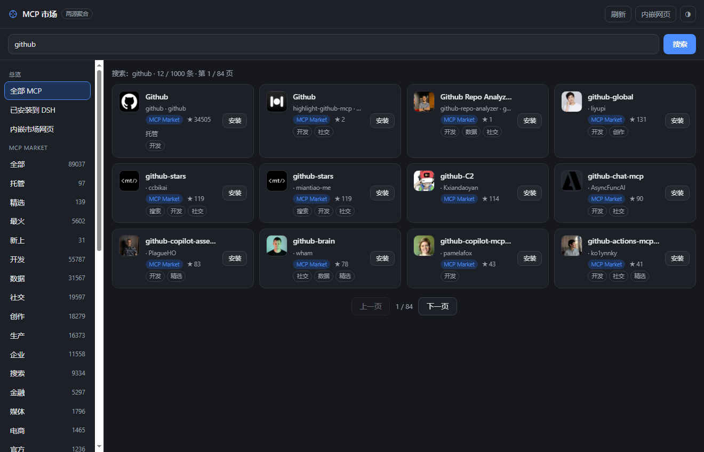

# dsh-mcp-market-hub

把两个 MCP 市场聚合进 DSH 侧栏，**按分类挑一个就装进当前 DSH**：**MCP Market（https://mcpmarket.cn）** 与 **魔搭 ModelScope MCP 广场**。

装完不需要重启：DSH 自带的 MCP 管理器会把条目实时注册成可调用的工具。

## 截图

| 市场首页 | 详情抽屉 |
| --- | --- |
|  |  |

| 已安装 | 搜索结果 |
| --- | --- |
|  |  |

更多见 [`screenshots/`](screenshots)。

## 要求

| 项 | 要求 |
| --- | --- |
| DSH | ≥ 0.1.5-rc.2（自带 `@deepseek-ai/dsh-mcp-manager`，0.2.x 已内置） |
| Node | `^22.19.0` 或 `>=24`（跟随宿主运行时） |
| 网络 | 能访问 `mcpmarket.cn` 与 `modelscope.cn`（只读公开接口，无需登录） |

宿主没有内置 MCP 管理器时插件仍可加载：此时安装会退化成写 `dsh-mcp-connector` 的连接文件，需要重载该插件才生效。

## 安装这个插件

```bash
cd ~/.dsh/profiles/<profile>
pnpm add dsh-mcp-market-hub
```

然后把 `dsh-mcp-market-hub` 加进该 profile 的 `package.json` → `dsh.profile.bundles`，重启 DSH。插件行由本包的 `cordis.patch.yml` 自动展开，不需要手写。

## 界面

侧栏「MCP 市场」。Host 侧用 prefix 路由把 `ui/` 当静态面板，侧栏里是一个同源 iframe。

- **左栏分类**：`全部 MCP`、`已安装`、`内嵌市场网页`，下面是 MCP Market 的中文分类（条数由 `/api/categories` 实时取）和魔搭的分类（中文标签 · 英文 id）。点分类即切列表。
- **卡片网格**：logo、标题、包名 · 作者、来源徽章（MCP Market / 魔搭）、★、托管、分类 chip、右侧「安装」。底部翻页显示「第 N / M 页」，M 来自接口返回的 `pageCount`。
- **详情抽屉**：说明、安装方式单选（stdio 的 `command/args/env`，或 streamable-http / sse 的 url）、「将安装的配置」JSON、底部「安装到 DSH」「复制 JSON」。
- **已安装**：列出本插件装过的服务、其实时注册状态、以及 `dsh-mcp-connector` 里的旧记录（只读）。每条可「卸载」。
- **内嵌市场网页**：mcpmarket.cn 允许被 iframe，直接内嵌原站；魔搭页面带 `X-Frame-Options: SAMEORIGIN`，内嵌会被浏览器拒绝，所以那里只给「新窗口打开」。
- 右上角「切换主题」在深/浅色间切换（存 localStorage）。

## 安装到底做了什么（重点）

优先路径 —— **DSH 内置 MCP 管理器**：

1. 插件通过 `ctx.inject(['mcpManager'], …)` 拿到宿主服务（软依赖：没有就不启用这条路径）。
2. 安装时调 `ctx.mcpManager.register(name, entry)`，entry 严格按宿主的 `ServerEntrySchema` 构造（stdio 只带 command/args/env/cwd，streamable-http 只带 url），实时生效。
3. 同时把这条记录写进本插件自己的文件，下次启动自动重放：

```
<DSH_HOME>/storages/mcp_market_hub.json     # DSH_HOME 未设时为 ~/.dsh
```

服务名必须匹配 DSH 的规则 `^[A-Za-z0-9_-]{1,32}$`；同名的不同条目会自动加后缀，不会互相覆盖。

回退路径 —— **dsh-mcp-connector**（宿主没有 mcp-manager 时）：

```
<DSH_HOME>/storages/mcp_connector.json      # tables.connections[<key>]
```

记录 schema 与 `dsh-mcp-connector` 的 `connectionRecordSchema` 一致。连接器只在 apply 阶段遍历 connections 建通道，不监听文件变化，所以这条路写完要重启 DSH 或重载该插件。

预览/dry-run 时把 `DSH_HOME` 指向临时目录，写入就落到那里，不碰真实配置。

## 端点规则

- **内置管理器**：把 URL 原样交给 `StreamableHTTPClientTransport`，**任何 http/https 地址都能装**（DSH 的 mcp-client 不限制协议）。唯一的例外是 **SSE**：宿主只认 `stdio` 与 `streamable-http`，纯 SSE 条目会被明确拒绝并说明原因。
- **连接器回退**：只接受 https、回环 http（127.0.0.1 / localhost / ::1）或显式放行的私网 http。

## 已知限制

1. **魔搭列表接口忽略分类/搜索参数**，一次只回 28 条；分类与搜索都在本地过滤，所以魔搭的分类条数永远是它的全集。
2. **mcpmarket 列表行没有连接配置**，点进详情才拉 `mcp_config` / `mcp_url`，抽屉会多一次请求。
3. **纯 SSE 条目装不进内置管理器**（见上）。详情页会直接说明，不会假装成功。

## 工具（Agent 可调用）

| 工具 | 作用 |
| --- | --- |
| `mcp_market_search` | 跨源搜索（query / source / category / page） |
| `mcp_market_detail` | 某条目的完整详情与可用连接方式 |
| `mcp_market_install` | 装进当前 DSH；默认 `apply:false` 只预览 |
| `mcp_market_installed` | 列出已安装服务与实时注册状态 |
| `mcp_market_uninstall` | 撤回注册并删除安装记录 |

## 结构

```
lib/market.js    两市场列表/详情/分类适配 → {source,id,name,title,subtitle,author,description,categories,tags,stars,hosted,url,icon,formats[]}
lib/install.js   端点判定 + mcp-manager 记录读写 + connector 回退写入（dshHome: DSH_HOME 或 ~/.dsh）
lib/index.js     Host：/dsh-mcp-market-hub/api + 五个工具 + mcpManager 软注入与启动重放
lib/ui.js        Host：prefix 路由 /dsh-mcp-market-hub/ui 提供静态面板（含 CSP、目录穿越防护）
ui/index.html    面板骨架
ui/app.css       深/浅两套变量与卡片、抽屉样式
ui/app.js        面板逻辑：分类栏、卡片、详情抽屉、安装/卸载、内嵌网页、主题
client.js        侧栏入口 + main 槽 iframe
```

## 数据来源（公开只读，无需鉴权）

- MCP Market：`GET https://mcpmarket.cn/api/servers?page=&search=&category=`、`/api/servers/<id>`、`/api/categories`
- 魔搭：`GET https://modelscope.cn/api/v1/mcpServers/list?PageNumber=&PageSize=`

## 发布

```bash
pnpm publish --access public --registry=https://registry.npmjs.org
```

带 `dsh-plugin` 关键字发布后，DSH 插件目录站点会自动收录（每日抓取 npm），不需要单独提交。

## License

MIT
